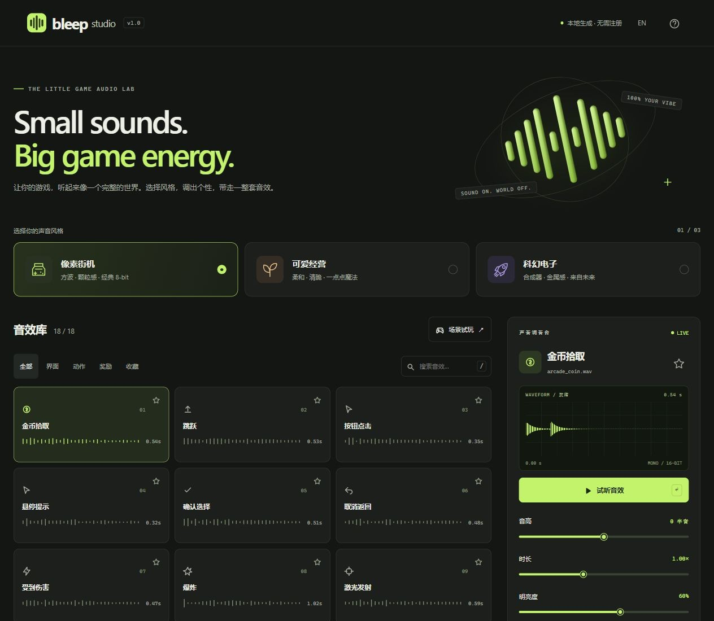

# Bleep Studio

**Small sounds. Big game energy.**

[中文说明](README.zh-CN.md) · MIT licensed · Zero runtime dependencies · No backend

Create a cohesive game sound pack in your browser. Pick a palette, tune each sound, and export 18 game-ready WAVs in one ZIP. Everything is synthesized locally using the Web Audio API. No account, paid API, remote samples, fonts, or analytics.

## Run

Open **index.html** in a current browser. No install or build step is needed.

For a stable localhost origin and browser-local saved settings:

    npm start

Then open http://127.0.0.1:4173. Node 18+ is only needed for the optional preview server and tests. It is not needed by visitors or by static hosting.

## Make your first pack

1. Choose **Pixel Arcade**, **Cozy Garden**, or **Space Signal**.
2. Click a sound tile to hear it and open its editor.
3. Adjust pitch, duration, brightness, punch and space. Remix creates a new reproducible seed.
4. Download the selected WAV or export all 18 sounds in the current palette.

Each sound keeps its own settings in each palette. Settings and favorites are stored only in this browser. Private browsing, browser cleanup or a different origin can remove or separate them.

## Included sounds

Coin pickup, jump, UI click, UI hover, confirm, cancel, damage, explosion, laser, power-up, level up, victory, game over, whoosh, notification, unlock, heal and error.

Three oscillator/filter/envelope palettes give 54 starting sounds. Tune them independently, save favorites, search in English or Chinese, and test them in a tiny interactive playground.

## Export format

- Mono, 16-bit PCM WAV at **44.1 or 48 kHz**.
- ZIP contains all 18 WAVs, **manifest.json** with the exact recipes, and engine integration notes.
- Preview volume and mute affect playback only; they do not alter downloads.
- Export uses a snapshot of all settings taken when the button is clicked.
- Library mini-bars are decorative sound motifs; the editor shows the actual rendered waveform.

Generated audio may be used in commercial or personal projects **without attribution**. All presets are original synthesis recipes with no third-party samples.

## Deploy free with GitHub Pages

Push this directory as the root of a repository with a **main** branch. In **Settings → Pages → Build and deployment**, choose **GitHub Actions**. The included workflow runs the unit tests and deploys only the static site files. Repository/account Pages availability is controlled by GitHub.

You can also upload index.html, style.css, app.js, engine.js and icon.svg to any static host. All URLs are relative, so repository subpaths work.

## Keyboard

- **1–9:** play a visible sound.
- **Space:** replay when the page body is focused. Native button and slider keyboard behavior is preserved.
- **M:** mute/unmute preview.
- **/**: focus search.
- **Esc:** close a dialog.
- Playground: **↑** jump, **C** coin, **H** damage, **V** victory.

## Engine API

Load engine.js as a regular script. It exposes **window.Bleep**.

    const buffer = await Bleep.render('coin', 'cozy', {
      pitch: 0, duration: 1, brightness: 60,
      punch: 55, room: 12, seed: 42
    }, 44100);
    const bytes = Bleep.wav(buffer);

Use a manifest entry with its palette and parameters to reconstruct a sound. A fixed seed reproduces a recipe; small numerical differences across browsers/versions are possible. This is procedural synthesis, not text-to-audio generation. It is best suited to stylized UI, arcade, casual and sci-fi effects rather than realistic recordings.

Playback requires a user gesture because browsers restrict autoplay. The first click creates/resumes the AudioContext. Rendering uses OfflineAudioContext and does not require microphone permissions. Current Chrome, Edge, Firefox and Safari are the intended targets; validation records the browsers actually tested in VALIDATION.md.

## Development and checks

    npm test

Open **/tests/browser.html** through the local server and run the browser audio suite. It renders all 54 presets at two sample rates and at parameter extremes, then checks finite samples, audible signal, peak limits, fade endpoints and repeatability. It can export a validation pack for external WAV/ZIP inspection.

No package installation is needed. The app uses vanilla HTML/CSS/JS, Web Audio and a small ZIP STORE encoder. The preview server binds only to 127.0.0.1.

## Files

| File | Purpose |
| --- | --- |
| index.html / style.css | Responsive, keyboard-accessible workstation |
| app.js | UI, playback, local settings, export and playground |
| engine.js | Seeded synthesis, WAV encoding and ZIP packaging |
| server.cjs | Optional local static preview |
| tests/ | Unit and browser-rendering tests |
| .github/workflows/pages.yml | Test and deploy static files |

## License

Source code: [MIT](LICENSE). Generated audio: free for personal and commercial use, no attribution required.

